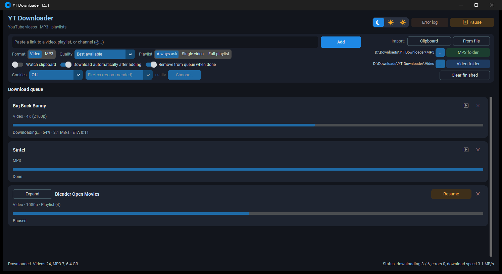

# YT Downloader

**Version 1.5.1**

A portable desktop app for YouTube — videos, MP3, and playlists.

**Česky:** [README.md](README.md)

## Preview

The main window. The interface language follows Windows (Czech, Slovak, German, Spanish, otherwise English). The queue in the picture is a sample.



## Quick start (new computer)

1. Copy the whole app folder anywhere (USB drive, `D:\`, …)
2. Double-click **`install.bat`** — installs Python, Node.js, ffmpeg, and the Python packages
3. Start **`YT Downloader.vbs`** (no command-prompt window)

## Portability

| What | Where |
|------|--------|
| App + Python packages | project folder (`.venv`) |
| Settings, queue, logs | `data\` inside the app folder |
| Downloaded videos / MP3 | default `Downloads\YT Downloader\` (changeable in the UI) |

To move the app to another PC, copy the whole folder including `.venv`. On the new PC, run **`install.bat`** again (it installs the system dependencies: Python, Node, ffmpeg).

## Scripts

| File | Purpose |
|------|---------|
| **`install.bat`** | One-time install of everything (Python 3.12, Node.js, ffmpeg, pip packages) |
| **`setup.bat`** | Create or update `.venv` only (no winget) |
| **`start.bat`** | Start the app (the command window closes) |
| **`YT Downloader.vbs`** | Start without a console (recommended) |

## Requirements (installed by `install.bat`)

- **Python 3.12+**
- **Node.js LTS** (full YouTube resolution)
- **ffmpeg** (MP3 and merging tracks)
- **winget** (part of Windows 10/11)

### Manual install (without winget)

```powershell
winget install Python.Python.3.12
winget install OpenJS.NodeJS.LTS
winget install Gyan.FFmpeg
```

Then run `setup.bat`.

## Features

- Video downloads up to 4K, MP3 extraction, playlists
- Playlist: always ask (pick videos), a single video, or the whole playlist
- Queue with a pause on each playlist, retry for failures, import from a file or the clipboard
- Loading a playlist listing takes priority over downloading files
- Separate folders for video and MP3
- Cookies for videos that require a sign-in
- Error log: `data\app.log`
- Interface language follows Windows: Czech, Slovak, German, Spanish, otherwise English

## Distribution package

A ready-made zip for other people is in **`_install\`** (`YT-Downloader-<version>.zip`).

On a new PC: unzip → `install.bat` → `YT Downloader.vbs`.

Build the zip (no user data, no `.venv`):

```powershell
powershell -ExecutionPolicy Bypass -File _install\make-dist.ps1
```

## Note

Download only content you have the right to save. Respect YouTube’s terms and copyright.
