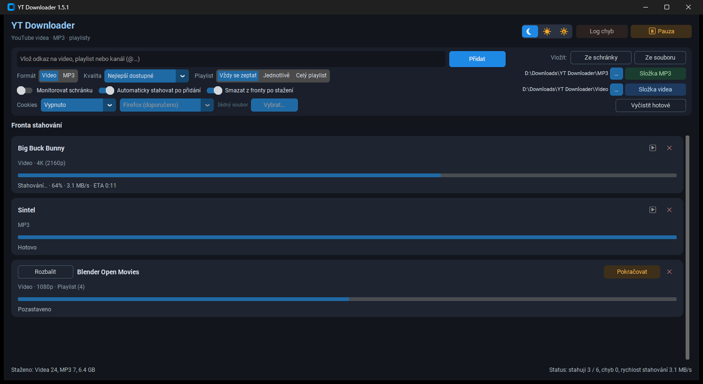

# YT Downloader

**Verze 1.5.3**

Přenositelná desktopová aplikace pro YouTube — videa, MP3, playlisty.

**English:** [README.en.md](README.en.md)

## Náhled

Hlavní okno. Jazyk rozhraní se bere z Windows (čeština, slovenština, němčina, španělština, jinak angličtina). Fronta na snímku je ukázková.



## Rychlý start (nový počítač)

1. Zkopíruj celou složku aplikace kamkoli (USB, disk D:…)
2. Dvojklik na **`install.bat`** — nainstaluje Python, Node.js, ffmpeg a Python balíčky
3. Spusť **`YT Downloader.vbs`** (bez CMD okna)

## Přenositelnost

| Co | Kde |
|----|-----|
| Aplikace + Python balíčky | složka projektu (`.venv`) |
| Nastavení, fronta, logy | `data\` ve složce aplikace |
| Stažená videa / MP3 | výchozí `Downloads\YT Downloader\` (lze změnit v UI) |

Pro přenos na jiný PC stačí zkopírovat celou složku včetně `.venv`. Na novém PC spusť znovu **`install.bat`** (doinstaluje systémové závislosti: Python, Node, ffmpeg).

## Skripty

| Soubor | Účel |
|--------|------|
| **`install.bat`** | Jednorázová instalace všeho (Python 3.12, Node.js, ffmpeg, pip balíčky) |
| **`setup.bat`** | Pouze vytvoří/aktualizuje `.venv` (bez winget) |
| **`start.bat`** | Spustí aplikaci (CMD se zavře) |
| **`YT Downloader.vbs`** | Spustí bez konzole (doporučeno) |

## Požadavky (instaluje `install.bat`)

- **Python 3.12+**
- **Node.js LTS** (plné rozlišení YouTube)
- **ffmpeg** (MP3, slučování stop)
- **winget** (součást Windows 10/11)

### Ruční instalace (bez winget)

```powershell
winget install Python.Python.3.12
winget install OpenJS.NodeJS.LTS
winget install Gyan.FFmpeg
```

Potom spusť `setup.bat`.

## Funkce

- Stahování videí až ve 4K, extrakce MP3, playlisty
- Playlist: vždy se zeptat (výběr videí), jednotlivě, nebo celý playlist
- Fronta s pauzou u každého playlistu, opakováním chyb, import ze souboru/schránky
- Načtení seznamu playlistu má přednost před stahováním souborů
- Oddělené složky pro video a MP3
- Cookies pro videa vyžadující přihlášení
- Log chyb: `data\app.log`
- Jazyk rozhraní podle Windows: čeština, slovenština, němčina, španělština, jinak angličtina

## Distribuční balíček

Hotový zip pro ostatní je ve složce **`_install\`** (`YT-Downloader-<verze>.zip`).

Na novém PC: rozbal → `install.bat` → `YT Downloader.vbs`.

Sestavení zipu (bez uživatelských dat, bez `.venv`):

```powershell
powershell -ExecutionPolicy Bypass -File _install\make-dist.ps1
```

## Aktualizace

Po startu aplikace zkontroluje [GitHub Releases](https://github.com/uzivatel457/YTB-downloader-by-u457/releases). Při nové verzi nabídne ignorovat, otevřít release, nebo nainstalovat (stáhne ZIP, přepíše soubory programu, zachová `data\` a `.venv`, spustí `setup.bat` a restartuje).

Vydání nové verze: sestav ZIP výše → na GitHubu vytvoř Release (tag `v1.x.y`) → přilož asset `YT-Downloader-<verze>.zip`.

## Changelog

[Známé a opravené chyby](CHANGELOG.md) podle issues na GitHubu. V aplikaci je tlačítko **Změny**.

## Poznámka

Stahuj pouze obsah, ke kterému máš oprávnění. Respektuj podmínky YouTube a autorská práva.
